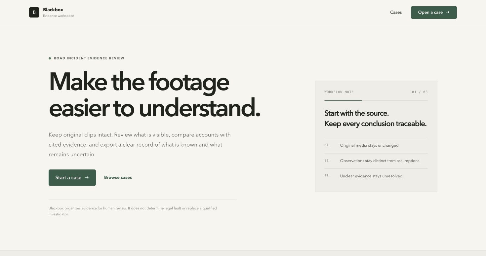
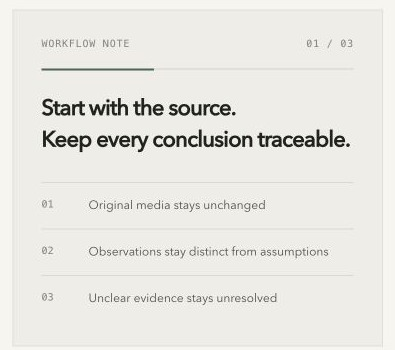

# Blackbox

**Road-incident evidence, organized for human review.**

Blackbox is a hackathon-stage software prototype for preserving road-incident media and helping a reviewer inspect what the footage supports, what remains uncertain, and what additional evidence could help. It is designed around source traceability and explicit limits. It does not issue legal fault findings.

> **Project status:** prototype, not a validated forensic product. Several analysis flows are conditional or experimental. A file hash records integrity from intake onward; it does not prove that footage was authentic before upload.

## Product screenshots

**Blackbox home**



**Evidence-handling detail cropped from the home screen**



These screenshots are from the local application. They show the current product interface, not a claim that every analysis service has been validated end to end.

## What the prototype contains

The repository includes a Next.js web application, a FastAPI service, Celery workers, a deterministic Python engine, and product and evaluation documentation.

| Capability | Current status |
| --- | --- |
| Case workspace, consent flow, and source-media intake | Interface and API paths are present; operation requires the web app, API, database, and worker services to be available. |
| Source-file hashes and processing history | Backend implementation records media integrity and processing metadata. A hash documents the bytes received; it is not an authenticity certificate. |
| Track review and ground-plane calibration | Prototype workflow. Tracking may use a local motion baseline or optional SAM 3.1 when configured and explicitly authorized. Calibration needs suitable points and measured distances for metric results. |
| Voice transcription and claim review | A Muse Voice adapter and transcript/claim workflows are present. Live transcription depends on Meta API access and configuration; extracted claims require human review. |
| Dynamics, counterfactuals, and rival hypotheses | Engine, API, worker, and UI paths are present. Outputs are conditional on reviewed tracks and calibration and are not validated forensic conclusions. |
| 3D replay, evidence-rescue tools, prevention aggregation, and exports | Prototype surfaces and code paths exist. Treat generated scenes as illustrative and the analytical results as unvalidated until independently evaluated. |

The repository's product requirements describe the intended product in more detail than the current validated implementation. See [docs/PRD.md](docs/PRD.md), [docs/EVALUATION.md](docs/EVALUATION.md), and [docs/SAFETY_PRIVACY.md](docs/SAFETY_PRIVACY.md).

## Design principles

- Preserve source media separately from derived files.
- Keep observed, measured, assumed, simulated, and unknown information distinct.
- Link review findings to source media and frame/time references wherever available.
- Fit motion from track evidence; do not use a witness statement to train the result that checks that statement.
- Withhold metric speed when scale or calibration is inadequate.
- Label generated or simulated visualizations as illustrative.
- When evidence does not support an answer, state that limitation instead of guessing.
- Keep a qualified human reviewer in control.

## Technology

- **Web:** Next.js, React, TypeScript
- **API:** FastAPI, Pydantic, SQLAlchemy
- **Background work:** Celery and Redis
- **Data:** PostgreSQL by default in Docker Compose; SQLite is available for local development
- **Media and geometry:** FFmpeg/ffprobe, OpenCV, NumPy, SciPy
- **Meta model adapters:** optional SAM 3.1 and Muse Voice integrations; they require valid credentials and user authorization before external media processing
- **3D interface:** custom Canvas-rendered scene viewer; the current implementation is a prototype, not a Three.js / React Three Fiber scene

The deterministic engine owns numerical outputs. A language model is not treated as the source of truth for physics or legal conclusions.

## Run locally

### Requirements

- Docker Desktop with Docker Compose
- Node.js 20 or newer
- Python 3.11 or newer
- `uv` for the Python setup target

### Setup

```bash
git clone https://github.com/krishnaChandak044/Blackbox-meta-ai-global-hackathon.git
cd Blackbox-meta-ai-global-hackathon
cp .env.example .env
```

Edit `.env` before starting. Set a private `BLACKBOX_ACCESS_PASSWORD` and a random `SECRET_KEY` of at least 32 characters. Keep real credentials out of Git. Meta model credentials are optional for local app startup; configure them only for the integrations you intend to use.

```bash
make setup
make dev
```

Open the web app at [http://localhost:3000](http://localhost:3000). The API health endpoint is [http://localhost:8000/health](http://localhost:8000/health), and the interactive API documentation is [http://localhost:8000/api/docs](http://localhost:8000/api/docs). The API root `/` is not the web application and may return 404; use the web URL for the interface.

To stop the Docker Compose services, press `Ctrl+C` in the terminal running `make dev`, or run `docker compose down` in another terminal.

## Meta API and media consent

The `.env.example` file documents the available configuration variables. Do not commit `.env` or expose API keys in client-side code. Before a clip is sent to an external model service, obtain the required consent in the application. If Meta APIs are not configured or available, use the local tracking path where supported and explain the resulting limits.

## Repository map

```text
apps/web/                 Next.js application and review interface
services/api/              FastAPI routes, authentication, schemas, database
services/worker/           Celery jobs, media processing, model adapters
engine/                     Geometry, tracking, claims, dynamics, simulation
contracts/                  Data contracts and typed evidence structures
evaluation/                 Evaluation fixtures and scorecard utilities
fixtures/                   Staged and synthetic media fixtures
docs/                       Product, architecture, safety, evaluation, and demo docs
```

## Evaluation and responsible use

Before presenting numeric performance as validated, evaluate against known ground truth and publish the dataset size, camera conditions, metrics, exclusions, and failures. Synthetic examples and a successful code path are not evidence of general accuracy.

Blackbox is not a legal decision tool, an authenticity detector, or a replacement for police, a collision reconstruction expert, or legal advice. Use staged or appropriately licensed footage for demonstrations. Do not use illustrative 3D scenes as source evidence.

## Background

The WHO estimated 1.19 million annual road-traffic deaths in its 2023 global status report. India's Ministry of Road Transport and Highways reported 172,890 road-traffic fatalities in 2023. These figures describe the scale of the safety problem; they do not establish Blackbox's market size or prove that usable video exists for every incident. Sources: [WHO Global status report on road safety 2023](https://www.who.int/publications/i/item/9789240086517) and [Road Accidents in India 2023, Ministry of Road Transport and Highways](https://morth.nic.in/sites/default/files/Road-Accident-in-India-2023-Publications.pdf).

## License

This project is released under the MIT License. See [LICENSE](LICENSE).
